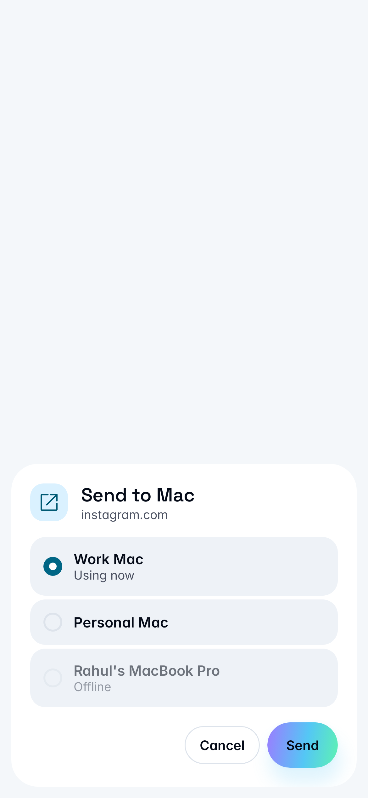
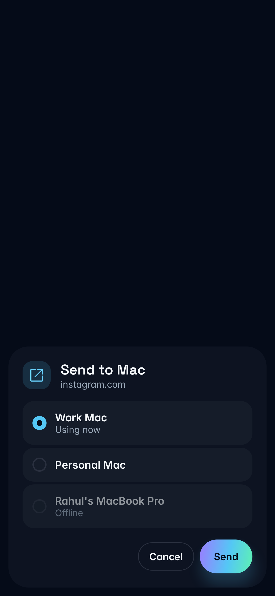

# Send to Mac

Owner: Rahul. Base: `rr/main`. This change replaces Android's two share targets with **Send to Mac**. The launcher name is **Bridgey** in English and Russian.

A link previously went to the selected Mac, could sit silently in its menu bar, and could be declined if another link was already there. Shares now own a named destination and show the outcome.

## Destination and controls

The phone chooses among connected, trusted Macs with the required feature enabled at both ends:

1. The unlocked Mac with input in the last two minutes, using the freshest recent-input estimate. Most recent wins; device ID breaks exact ties.
2. The Mac this phone last shared to successfully, if connected and eligible.
3. The only eligible connected Mac.
4. Otherwise, show the list.

**Settings > Media and quick actions > When I share** chooses **Send to the Mac I'm using** (default) or **Always ask**. This choice and the last successful destination stay on this phone. Always ask preselects the suggested Mac without sending. Offline Macs stay visible and disabled.

Automatic sending has a visible 1.5-second grace period with **Change** and **Cancel**. Backgrounding pauses it; returning starts a full grace period. Change cancels automatic sending and opens the list. The destination and authenticated session are fixed before dispatch. A disconnect, replacement session or permission change fails that attempt instead of choosing another Mac. Retry is an explicit action and may use the named Mac's new session. Rotation preserves the operation; process death requires a fresh choice.

Links request browser opening. Unset **Open links from phones right away** now means on; explicit off stays off. With it off, the newest link replaces the parked one and the phone explains how to find it in Bridgey's menu bar. Explicit shares keep the three-second per-phone rate limit. Browser failures, rate limits and delivery timeouts get visible results. Opened, copied and completed file sends close the sheet after 1.6 seconds. A parked link keeps its directions visible until Close.

Plain text uses the named Mac's Clipboard grant and normal delivery acknowledgement. `share_receive_draft1` adds `clipboard.share`, which shows a small notification with only the phone name. Older Macs receive `clipboard.update`. Text over 32 KiB asks to be sent as a file. Files use the normal transfer queue; the sheet waits for its own batch and retries only failed files.

## Presence and privacy

Only the presence portion of PR #7 is ported: `device_presence_draft1`, strict shared vectors, the Mac sampler/publisher and Android's in-memory store. PR #7 should rebase onto this change. Notification routing, call/media work from #5, Attach drafts and Mac send/menu-bar choosers are outside this change.

**Mac Settings > Notifications > Share when I'm using this Mac** starts on and can be turned off. Sampling runs only while a trusted, compatible protocol-2 phone subscribes. Agent devices and Mac peers cannot subscribe. The Mac reads aggregate idle time, without keys, foreground app names, screenshots or browsing history. Lock and sleep report unavailable immediately.

Samples carry active/idle/locked/unknown and whole seconds since input. Android uses its own monotonic arrival time, expires samples at 20 seconds, and adds sample age to the input age. Sequence fences reject reordered packets and survive same-session opt-out. Reconnect, disconnect and forgetting invalidate old samples. See [the contract](protocol-contract.md) and [shared vectors](../protocol/test-vectors/device-presence-v1.json).

Link activity now records the sending session's phone ID and name, independently of the selected device.

## Exported share activity

Any foreground app can explicitly launch Android's exported share activity. Android does not establish that a share came from a deliberate tap in another app. The residual risk is that an app can present a share and, after the visible grace period, send arbitrary text, an HTTP(S) link or a readable external content URI to an already trusted and permitted Mac. A link could open an unwanted web page. No custom URL scheme is executed, no internal/file URI is accepted, and no new trust or grant is created. ACTION_SEND and SEND_MULTIPLE are the only accepted actions. The primary-user check and both devices' existing feature grants remain required. **Always ask**, Change and Cancel let the owner prevent automatic sends.

## Validation

Results and screenshots are recorded here after live checks. No installed Bridgey app, real phone setting or real Mac pairing may be changed for this acceptance run. Test builds use their own app/bundle IDs, support folders, ports and Handoff preference domain. Release signing identities are not used.

The throwaway Mac's debug controls add `share-presence` (active/idle/locked/system), `share-links-now` (on/off) and `share-browser` (an absolute executable path). They run only with `BridgeyTestInstance`; the browser hook lets acceptance open an owned agent-browser tab without touching an everyday browser. Forced presence tests exercise the real publisher, encrypted session, phone store and routing. They do not prove transitions across three physical Macs.

### Check results, 11 November 2026

- Android: debug and unsigned minified release builds, lint, and 68 scoped unit/contract/vector/search/screenshot checks passed on the backup Mac. The personal Mac also built both variants with the Rust core.
- Mac: 23 focused tests passed on the personal Mac against the first implementation snapshot (`af72ece`). Later setup-default, search/copy and parked-sender changes need the queued current-revision Mac test run. The normal app and isolated test bundles built on the backup Mac with SDK 26.5. Its default SDK 27.2 has a missing SwiftUI macro plugin; the CLT installation also lacks XCTest, so full Mac tests remain for RR CI.
- Python: all 103 checks passed on contabo, including protocol coverage and generated tables.
- Live: the test-signed minified APK launched and completed setup on `bridgey-api36`, under the separate `in.roundrobin.bridgey.shareqa` ID.
- Blocked: the device tool twice returned `android-app-close-timeout` while stopping the emulator's existing Bridgey process, including its prescribed debug retry. Device driving stopped. Link opening on the active Mac, Always ask, lock/idle fallback, offline rows, actual light/dark share captures and performance acceptance remain open. No adb/SSH UI workaround was used. RR CI is queued.

The PNGs below are **rendered Robolectric fixtures**, not live emulator evidence. They show the actual Compose sheet at 390 × 844 dp. Both palettes, active/preselected and offline rows, grace, failure, success and long names were inspected. No visible text or button clipping was found. Timing and performance are not certified from these images.

| Light | Dark |
| --- | --- |
|  |  |

[Grace](screenshots/share-flow/rendered-grace-light.png), [failure](screenshots/share-flow/rendered-failure-dark.png), [success](screenshots/share-flow/rendered-opened-light.png), [long name](screenshots/share-flow/rendered-long-name-dark.png).
